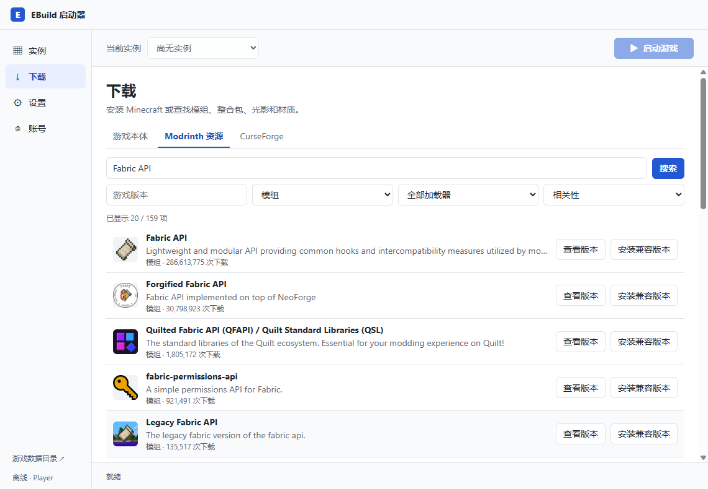

# EBuild 启动器

EBuild 是一个 MIT 许可的 Windows x64 Minecraft Java 版桌面启动器。

[下载 dev.0.1.0 预发行版](https://github.com/eee22323232/EBuild/releases/tag/dev.0.1.0)



- 安装原版、Fabric 或 NeoForge。一个 Minecraft 版本可以创建多个独立实例，共用下载的游戏文件和 Java。
- 在 Modrinth 搜索模组、整合包、光影和材质。可自动匹配实例或手动选版本，安装前会列出必需依赖。
- 从 Modrinth 安装或从磁盘导入 `.mrpack` 时创建独立实例。目前支持原版、Fabric 和 NeoForge 整合包。
- 全局游戏设置涵盖 Java、内存、窗口分辨率和启动后行为。单个实例可以覆盖全局值。设置还提供主题、代理、下载并发、GC、启动参数、日志和缓存清理。
- 默认使用离线档案。已有获批的 EBuild Microsoft Entra Client ID 时，可以在「账号」页配置并使用微软设备代码登录。正版端到端登录仍需用获批应用和有游戏权限的账号验证。

CurseForge 和双源聚合待接入。CurseForge API 由项目方申请，分发版应通过保管 API Key 的服务端调用。Forge、Quilt 可用于搜索筛选，实例安装在后续版本支持。 [CurseForge 申请](https://support.curseforge.com/support/solutions/articles/9000208346) · [Minecraft Services 申请](https://aka.ms/mce-reviewappid)

## 运行

把发布包解压到磁盘的子文件夹，再双击 `EBuild.exe`。默认游戏数据目录是 EXE 同级的 `游戏数据`。可在「启动器设置」更换目录，默认复制并校验现有数据，保留旧目录。安装目录须可写，且 EXE 不能直接放在磁盘根目录。

首次安装需要联网。成功安装后可用离线档案和本地文件启动，日志默认保存在实例目录中的 `logs/ebuild-launch.log`。凭据通过 Windows 加密保存在当前 Windows 用户配置目录中。

## 从源码运行

在 Windows x64 上使用 Node.js 24 和 npm。

```powershell
npm ci
npm start
```

`npm run package` 会生成 `dist/EBuild-win32-x64`。启动器从 Mojang 获取游戏清单及资源，需要下载 Java 时使用 Eclipse Temurin。参见 [MIT 许可证](LICENSE)。
